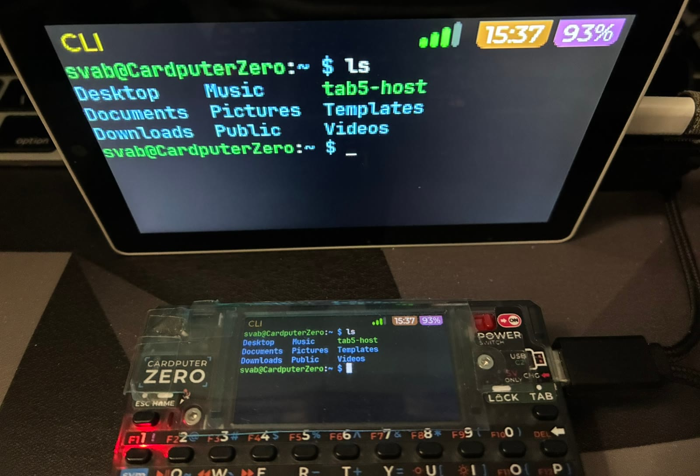

# Tab5 display link

Turns an [M5Stack Tab5](https://docs.m5stack.com/en/core/Tab5) into a USB screen, touchscreen and keyboard for a small Linux computer. Tested with the [M5Stack Cardputer Zero](https://docs.m5stack.com/en/CardputerZero).

The Linux side runs as a USB device (gadget). It captures its screen, encodes 1280 × 720 JPEG frames (15 fps target) and sends them over USB 2.0 high speed. The Tab5 is the USB host: it decodes the frames in hardware, rotates them for its 720 × 1280 panel and displays them. Touches and key presses on the Tab5 go back to Linux as virtual input devices. The Tab5 also powers and charges the Linux device through its USB-A port.



Status: proof of concept. The video, touch, keyboard and charging paths work on real hardware.

## Hardware

- M5Stack Tab5. Tested with ESP32-P4 chip revision v1.0.
- A Linux computer with a USB device controller, configfs and FunctionFS. Tested with a Cardputer Zero (Raspberry Pi CM0, Debian 13, aarch64).
- A cable from the Tab5 **USB-A** port to the Linux device's USB device port. On the Cardputer Zero this is the **right** USB-C port.
- Optional: an I2C keyboard at address `0x6d` on the Tab5 (key map from [M5Unit-KEYBOARD](https://github.com/m5stack/M5Unit-KEYBOARD)).

## Repository layout

| Path | Contents |
| --- | --- |
| `firmware/` | ESP-IDF firmware for the Tab5 |
| `src/`, `native/` | `tab5-host`, the Linux program (Rust with a small C helper) |
| `tests/`, `firmware/tests/` | Rust integration tests and C host tests for the firmware |

## Firmware

Requires ESP-IDF 5.5.2 or a newer 5.5.x release. The component manager downloads the Tab5 board support package and its dependencies on the first build.

```sh
cd firmware
idf.py set-target esp32p4
idf.py build
idf.py -p /dev/cu.usbmodem1101 flash   # use your serial port
```

`sdkconfig.defaults` targets ESP32-P4 revisions below v3.0, which is what current Tab5 units ship with. ESP-IDF cannot build one binary for both chip generations. For a rev v3.x chip, remove the `CONFIG_ESP32P4_SELECTS_REV_LESS_V3` and `CONFIG_ESP32P4_REV_MIN_100` lines and delete the generated `sdkconfig` before building.

Check the chip revision with `esptool.py --chip esp32p4 -p <port> flash_id`.

## Linux host

`tab5-host` builds only for Linux:

```sh
cargo build --release
```

Run-time requirements:

- root, for configfs, FunctionFS and `/dev/uinput`
- `libturbojpeg.so.0` (the `libturbojpeg0` package), loaded at run time
- FFmpeg, only for the `drm` capture source

### Cardputer Zero setup

1. Set the Host/Slave switch on the left side to **Slave**. Only then is the CM0 USB connected to the right USB-C port.
2. In `/boot/firmware/config.txt`, under `[all]`, change `dtoverlay=dwc2` to `dtoverlay=dwc2,dr_mode=peripheral` and reboot.

In Slave mode, the internal USB hub is disconnected: the USB-A port, the left USB-C port, the HAT USB lines and USB Ethernet stop working. Wi-Fi keeps working.

### Usage

```sh
sudo ./tab5-host doctor
sudo ./tab5-host serve --source framebuffer --device /dev/fb0
```

| Command | Purpose |
| --- | --- |
| `doctor` | Read-only check of framebuffer, DRM, USB device controller, configfs, FunctionFS and uinput |
| `serve` | Creates the USB gadget, streams the screen and injects input until interrupted, then removes the gadget |
| `capture` | Writes MJPEG frames to a new file without touching USB; sources `framebuffer`, `drm` or `test-pattern` |

Options: `--source framebuffer|drm`, `--device <path>`, `--quality 1..95` (default 65). `capture` also takes `--file` and `--frames`.

`serve` creates a temporary gadget named `tab5-display-link` and removes it on exit. It leaves no persistent system changes.

## USB protocol

The gadget exposes one vendor interface (class `FF`, subclass `54`, protocol `35`) with two bulk endpoints.

- **Video, bulk IN:** each frame starts with a 16-byte header: `T5F1`, sequence number (u32 LE), JPEG length (u32 LE), width (u16 LE, 1280) and height (u16 LE, 720). The baseline JPEG follows, at most 1 MiB.
- **Input, bulk OUT:** 16-byte records starting with `T5I1`; byte 4 is the type. Type 1 carries an 8-byte HID boot keyboard report at offset 8. Type 2 carries a pointer: x (u16 LE), y (u16 LE) and a pressed flag at offsets 8, 10 and 12.

## Tests

```sh
cargo test          # Linux only

cc -std=c11 -Wall -Wextra -I firmware/main -o protocol_test firmware/tests/protocol_test.c firmware/main/protocol.c && ./protocol_test
cc -std=c11 -Wall -Wextra -I firmware/main -o keyboard_state_test firmware/tests/keyboard_state_test.c firmware/main/keyboard_state.c && ./keyboard_state_test
```

## Known limitations

- On the Cardputer Zero, the `drm` source fails: FFmpeg `kmsgrab` needs a linear 32-bit BGR0 scanout, but the SPI panel does not provide one. Use the `framebuffer` source; the Tab5 then shows the 320 × 170 screen scaled up.
- The gadget uses USB ID `1209:0001`, the pid.codes test ID. Products distributed to others need their own vendor and product ID.
- With USB-A power enabled, the Tab5 battery also supplies the Linux device when no charger is connected.

## No warranty, use at your own risk

This project comes with absolutely no warranty of any kind. You use it entirely at your own risk.

It flashes device firmware, changes the boot configuration of the Linux device, creates USB gadgets as root and supplies 5 V power and battery charging between two battery-powered devices. Any of these can leave a device unbootable, drain or damage a battery, damage hardware or lose data. The authors are not liable for any damage or loss. Back up your firmware and data before you start.

## License

MIT, see [LICENSE](LICENSE). The keyboard map derives from MIT-licensed code by M5Stack and Yejun Yang; see [firmware/THIRD_PARTY_LICENSES](firmware/THIRD_PARTY_LICENSES). ESP-IDF components downloaded at build time keep their own licenses (Apache-2.0 and ESPRESSIF MIT).
